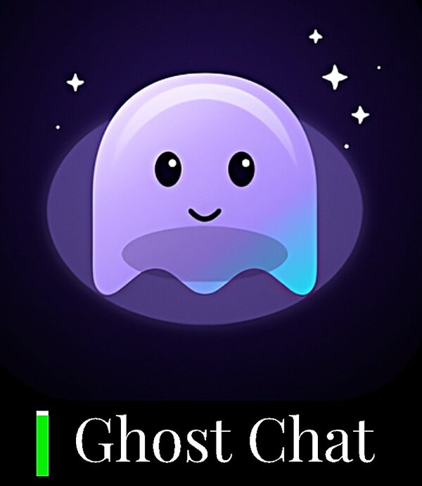

# GhostChat

**Anonymous, end-to-end encrypted, ephemeral chat** — built entirely on an Android phone. No accounts, no servers, no logs.

GhostChat turns an Android device into a self-contained chat server:
- Runs an HTTP/WebSocket server on 127.0.0.1
- Exposes it to the internet via Cloudflare Quick Tunnel
- Generates a passphrase (E2EE) and 3 invite codes
- Participants open a link in any browser, enter the passphrase, and chat

The session is ephemeral: it lives as long as the app is running. No messages are stored anywhere. No metadata survives the session.

---

## Features

- **End-to-end encryption** (AES-GCM 256, PBKDF2 250k, ECDSA P-256)
- **Forward secrecy per message** (HKDF-derived key per message)
- **Zero persistence** — server is a blind relay, no logs, no database
- **Zero accounts** — no email, no phone number, no registration
- **Anonymous nicknames** — generated client-side
- **Multi-language UI** — Italiano, English, Español
- **Embedded Cloudflare Tunnel** — no port forwarding, no public IP
- **Foreground Service** — resists aggressive Android ROMs (EMUI, MIUI)
- **Reconnect** — automatic reconnect with grace period after network drops
- **Ghost emoji reactions** — 👻❤️ 👻🔥 👻💀 and more
- **FLAG_SECURE** — blocks screenshots of the app

## Why GhostChat?

Running Cloudflare Tunnel on Android without root has been **broken for years**. The official `cloudflared` (Go) fails because its DNS resolver tries `[::1]:53`, which doesn't exist on non-rooted Android.

GhostChat solves this by using a **pure-Rust QUIC client** ([`cloudflare-quick-tunnel-rs`](https://github.com/shadow3aaa/cloudflare-quick-tunnel-rs)) forked with:

- **JNI bindings** to call it from Flutter
- **Custom DoH resolver** (hickory) to bypass OEM DNS filtering
- **`webpki-roots`** bundled for TLS validation without system CAs

Result: a **native Android app** that runs Cloudflare Quick Tunnel with **no root, no Termux, no VPS, no `cloudflared` subprocess**.

---

## Demo



👉 [Watch the full video on Facebook](https://fb.watch/v/39szwM0JY/)

---

## Architecture
ANDROID HOST
Flutter App (Dart)

SessionServer (HTTP + WS on 127.0.0.1:8080)

MethodChannel -> Kotlin

UI (IT/EN/ES)
|
v JNI
libqttunnel_jni.so (C wrapper, ~6 KB)
|
v FFI
libqttunnel.so (Rust, ~14 MB)

cloudflare-quick-tunnel-rs (fork)

QUIC + capnp-RPC to CF edge

DoH resolver (hickory) for filtered DNS
|
v QUIC
Cloudflare Edge
|
v HTTPS/WSS
Browser A, Browser B, Browser C                                                                                                                                                                                                                                                                   
---

## Tech stack

| Layer | Technology |
|---|---|
| UI (host) | Flutter 3.27 (Dart) |
| Bridge | Kotlin + JNI |
| Tunnel | Rust (forked cloudflare-quick-tunnel-rs) |
| DNS | hickory-resolver (DoH) |
| Server | Dart (shelf + shelf_web_socket) |
| Client | Vanilla JS + WebCrypto |
| Crypto | AES-GCM 256, PBKDF2-SHA256, HKDF-SHA256, ECDSA P-256 |

---

## Build

### Prerequisites

| Component | Version |
|---|---|
| Flutter | 3.27+ |
| Rust | 1.86+ |
| NDK Android | 27.0.12077973 |
| patchelf | 0.18+ |
| gcc | 12+ |
| JDK | 17+ |

### 1. Clone the repository

```bash
git clone https://github.com/ai-tech-db/ghostchat.git
cd ghostchat
```

### 2. Build the Rust tunnel

```bash
cd rust/cloudflare-quick-tunnel-rs

export NDK=$HOME/android-sdk/ndk/27.0.12077973
export NDK_BIN=$NDK/toolchains/llvm/prebuilt/linux-x86_64/bin
export CC_aarch64_linux_android=$NDK_BIN/aarch64-linux-android26-clang
export CXX_aarch64_linux_android=$NDK_BIN/aarch64-linux-android26-clang++
export AR_aarch64_linux_android=$NDK_BIN/llvm-ar
export CARGO_TARGET_AARCH64_LINUX_ANDROID_LINKER=$CC_aarch64_linux_android

cargo build --release --target aarch64-linux-android

cp target/aarch64-linux-android/release/libdl_cloudflare_quick_tunnel.so \
   ../../android/app/src/main/jniLibs/arm64-v8a/libqttunnel.so

patchelf --set-soname libqttunnel.so \
   ../../android/app/src/main/jniLibs/arm64-v8a/libqttunnel.so
```

### 3. Build the JNI wrapper

```bash
cd ../..

NDK=$HOME/android-sdk/ndk/27.0.12077973
SYSROOT=$NDK/toolchains/llvm/prebuilt/linux-x86_64/sysroot
CC=$NDK/toolchains/llvm/prebuilt/linux-x86_64/bin/aarch64-linux-android26-clang

$CC -shared -fPIC \
  -Wl,-soname,libqttunnel_jni.so \
  -I$SYSROOT/usr/include \
  -o android/app/src/main/jniLibs/arm64-v8a/libqttunnel_jni.so \
  android/app/src/main/cpp/qttunnel_jni.c \
  android/app/src/main/jniLibs/arm64-v8a/libqttunnel.so \
  -llog
```

### 4. Build the APK

Debug build (for testing):

```bash
flutter pub get
flutter build apk --debug
```

Release build (requires a keystore):

1. Generate a keystore:

```bash
keytool -genkey -v \
  -keystore android/app/ghostchat-release.jks \
  -keyalg RSA -keysize 2048 -validity 10000 \
  -alias ghostchat
```

2. Create android/key.properties:

```
storePassword=YOUR_PASSWORD
keyPassword=YOUR_PASSWORD
keyAlias=ghostchat
storeFile=ghostchat-release.jks
```

3. Build:

```bash
flutter build apk --release
```

Output: build/app/outputs/flutter-apk/app-release.apk

---

## Security

GhostChat uses a defense-in-depth approach:

- **E2EE** (AES-GCM 256) — server never sees plaintext
- **PBKDF2** (250k iterations) — resists offline brute force
- **Forward secrecy per message** (HKDF) — each message uses a unique key
- **ECDSA P-256 signatures** — prevents spoofing
- **Padding** (256-byte blocks) — hides message length
- **Replay protection** — monotonic per-sender counter
- **Blind relay** — server doesn't decrypt, doesn't persist
- **HTTP security headers** — CSP, X-Frame-Options, Referrer-Policy

**What it does NOT protect against**:
- Metadata visible to Cloudflare (IP, timestamp)
- Compromised client browser (extensions, malware)
- Anyone who knows the passphrase (group chat)
- Full forward secrecy (no DH ratchet, not Signal protocol)

See SECURITY.md for the full threat model.

---

## Project structure

```
ghostchat/
  android/                       # Android app (Kotlin + C)
    app/src/main/
      cpp/qttunnel_jni.c         # JNI wrapper
      jniLibs/arm64-v8a/         # Native libraries
      kotlin/com/aitechdb/ghostchat/
        MainActivity.kt
        GhostChatService.kt
      res/                       # Icons, styles
  assets/
    icons/                       # App icon (SVG + PNG)
    web_client/                  # Web client (HTML/CSS/JS)
      index.html
      style.css
      app.js                     # E2EE + WebSocket
      strings_web.js             # IT/EN/ES translations
  lib/                           # Flutter app (Dart)
    main.dart                    # UI
    l10n/strings.dart            # IT/EN/ES translations
    server/                      # Embedded HTTP/WS server
      session_server.dart
      token.dart
      models/session.dart
  rust/
    cloudflare-quick-tunnel-rs/  # Fork of the Rust tunnel
  LICENSE                        # Apache 2.0
  NOTICE                         # Third-party attributions
  SECURITY.md                    # Threat model
  README.md                      # This file
```

---

## Credits

- **Fork base**: shadow3aaa/cloudflare-quick-tunnel-rs (MIT OR Apache-2.0)
- **Flutter SDK**: The Flutter Authors (BSD-3-Clause)
- **Dart packages**: see pubspec.yaml (MIT/BSD)
- **Rust crates**: see Cargo.lock (MIT/Apache-2.0/BSD)

See NOTICE for full attributions.

---

## License

Licensed under the **Apache License, Version 2.0**.
See LICENSE for the full text.

You are free to:
- ✅ Use commercially
- ✅ Modify
- ✅ Distribute
- ✅ Sublicense
- ✅ Sell

Provided you:
- 📝 Include the license and NOTICE
- 📝 State significant changes
- 📝 Preserve attributions

---

## Contributing

See CONTRIBUTING.md for guidelines.

---

## Contact

- **Issues**: https://github.com/ai-tech-db/ghostchat/issues
- **Discussions**: https://github.com/ai-tech-db/ghostchat/discussions

---

**GhostChat** — Entri. Parli. Svanisci.

*By AI-Tech-DB*
